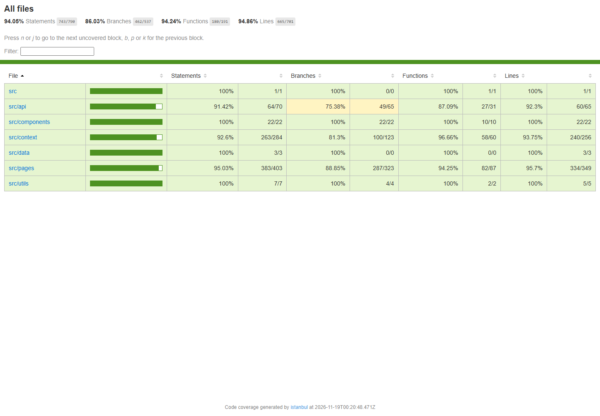

# INFORME DE COBERTURA DE PRUEBAS UNITARIAS

| | |
|---|---|
| **Proyecto** | Level-Up Gamer |
| **Alumno** | Tomás Torres Delgado |
| **Asignatura** | DSY1104 – Desarrollo Fullstack II |
| **Evaluación** | Evaluación Parcial N.° 3 y Evaluación Final de Taller (EP3 + EFT) |
| **Institución** | Duoc UC |
| **Fecha** | Noviembre 2026 |
| **Versión** | 3.0 |

---

## Índice

1. Introducción
2. Objetivo
   - 2.1 Objetivo general
   - 2.2 Criterio de aceptación
3. Alcance
   - 3.1 Módulos incluidos
   - 3.2 Elementos excluidos
4. Entorno y herramientas utilizadas
5. Metodología
   - 5.1 Instrumentación del código fuente
   - 5.2 Ejecución en navegador real
   - 5.3 Backend simulado y sincronización de efectos
   - 5.4 Generación de datos y reportes
   - 5.5 Indicadores de Istanbul
6. Ejecución de las pruebas y generación de cobertura
7. Resultados de cobertura
   - 7.1 Cobertura global
   - 7.2 Cobertura por módulo
   - 7.3 Archivos con menor cobertura
8. Análisis y cumplimiento del umbral
9. Evidencia
10. Conclusión
11. Anexos
    - Anexo A: comandos utilizados
    - Anexo B: archivos de configuración
    - Anexo C: ubicación de archivos
    - Anexo D: resultado de pruebas

---

## 1. Introducción

El presente informe documenta la cobertura de código alcanzada por las pruebas del frontend de **Level-Up Gamer**, una tienda online de productos para gamers desarrollada para DSY1104.

En esta versión la aplicación dejó de funcionar solo en el navegador: el frontend React se integra con cuatro microservicios Spring Boot (`ms-login`, `ms-productos`, `ms-carrito` y `ms-pagos`) mediante peticiones HTTP con JWT. Por lo tanto, las pruebas ya no se limitan al renderizado: también verifican el flujo completo de autenticación, catálogo, carrito con cupones y pagos contra un backend simulado que reproduce las respuestas reales de los cuatro servicios.

Las pruebas están implementadas con **Jasmine** y se ejecutan con **Karma** en un navegador real. La cobertura se mide sobre el código fuente de `src/` con **Istanbul**, instrumentado dentro del empaquetado de esbuild.

## 2. Objetivo

### 2.1 Objetivo general

Evidenciar el porcentaje de cobertura alcanzado por las pruebas del frontend, verificando el cumplimiento del umbral mínimo exigido de **60% de líneas cubiertas**, además de comprobar que las 190 pruebas se ejecutan sin fallos.

### 2.2 Criterio de aceptación

| Indicador | Umbral mínimo exigido |
|---|---|
| Líneas cubiertas (Lines) | **≥ 60%** |
| Pruebas fallidas | **0** |

## 3. Alcance

El análisis se realiza únicamente sobre el código fuente de la aplicación, ubicado en `fullstack2/level-up-react/src/`.

### 3.1 Módulos incluidos

| Módulo | Contenido |
|---|---|
| `api/` | `cliente.js` (peticiones HTTP y lectura de variables de entorno) y `mapeo.js` (traducción de respuestas de la API al modelo del frontend) |
| `components/` | `Header.jsx`, `Footer.jsx`, `ProductCard.jsx`, `Campo.jsx`, `RutaAdmin.jsx` |
| `context/` | `AuthContext.jsx`, `CarritoContext.jsx`, `ProductosContext.jsx` |
| `data/` | `ProductosIniciales.js` y `regiones.js` |
| `pages/` | `Home`, `Productos`, `Categorias`, `Ofertas`, `ProductoDetalle`, `Carrito`, `Checkout`, `CompraExitosa`, `CompraFallida`, `Login`, `Registro` y `Admin` |
| `utils/` | `precios.js` |
| Raíz | `App.jsx` (definición de rutas) |

### 3.2 Elementos excluidos

- La carpeta `tests/`, que contiene las propias pruebas y su configuración.
- `node_modules/`, dependencias de terceros.
- `dist/`, `coverage/` y el código compilado.
- Los archivos de configuración (`karma.conf.cjs`, `karma.pp.cjs`, `vite.config.js`).

## 4. Entorno y herramientas utilizadas

| Herramienta | Versión / función |
|---|---|
| Jasmine | 7 – framework de pruebas (`describe`, `it`, `expect`) |
| Karma | 6 – ejecutor que lanza el navegador y recopila los resultados |
| Microsoft Edge / Google Chrome headless | navegador real sin interfaz gráfica donde corren las pruebas |
| @testing-library/react | 16 – renderizado de componentes y consultas al DOM |
| @testing-library/user-event | 14 – simulación de clics y escritura del usuario |
| esbuild | 0.28 – transpilación de JSX y empaquetado de las pruebas |
| istanbul-lib-instrument | instrumentación del código fuente con contadores de ejecución |
| karma-coverage | 2.2 – recolección y generación de reportes (`json`, `html`, `text-summary`) |
| oxlint | análisis estático del código (`npm run lint`) |
| Vite | 8 – compilación de producción (`npm run build`) |

### Archivos de configuración

| Archivo | Propósito |
|---|---|
| `karma.conf.cjs` | Define navegador, archivos de prueba, preprocesadores, reportes y ejecución única |
| `karma.pp.cjs` | Preprocesador propio: empaqueta con esbuild e instrumenta `src/` con Istanbul cuando se usa `--coverage` |
| `tests/setup.js` | Matchers personalizados, limpieza de `localStorage` y `fetch` que falla por defecto |
| `tests/utils.jsx` | Renderizado con los tres proveedores y helper `esperarEfectos()` para pruebas de hooks |

## 5. Metodología

### 5.1 Instrumentación del código fuente

Instrumentar el bundle final generado por esbuild producía un reporte vacío (`0/0`), porque el código ya estaba minificado y no conservaba la estructura de los archivos originales. Por eso se instrumenta el **código fuente** dentro de un plugin de esbuild:

```js
build.onLoad({ filter: /[\\/]src[\\/].*\.(js|jsx)$/ }, async (args) => {
  const codigo = await fs.promises.readFile(args.path, 'utf8')
  return {
    contents: instrumenter.instrumentSync(codigo, args.path),
    loader: args.path.endsWith('.jsx') ? 'jsx' : 'js',
  }
})
```

El instrumenter se crea con `esModules: true` y una lista de `parserPlugins` que incluye `jsx`, `importMeta`, `dynamicImport` y sintaxis moderna. Así las líneas del informe coinciden con los archivos reales de `src/`.

### 5.2 Ejecución en navegador real

Karma lanza Edge o Chrome en modo headless (se detecta automáticamente la ruta del ejecutable). Las pruebas corren en un DOM real, lo que permite validar navegación con React Router, eventos del usuario y el comportamiento de `localStorage`.

### 5.3 Backend simulado y sincronización de efectos

`tests/fakeBackend.js` instala un `fetch` que reproduce los cuatro microservicios, incluyendo códigos HTTP y errores (`400`, `401`, `403`, `404`, `409`, `503`). `tests/setup.js` hace que cualquier petición sin backend simulado falle de inmediato, para que una prueba no dependa accidentalmente de otra.

En las pruebas de hooks con `renderHook`, `waitFor` no siempre se despierta porque no hay cambios en el DOM. Se usa el helper `esperarEfectos()` de `tests/utils.jsx`, que ejecuta dos ciclos de `act(async () => {})` antes de las aserciones.

### 5.4 Generación de datos y reportes

Al terminar la ejecución se generan:

- `coverage/coverage-final.json`: datos crudos de cobertura por archivo.
- `coverage/html/index.html`: reporte HTML navegable con detalle línea por línea.
- Resumen en texto en la consola (`Statements`, `Branches`, `Functions`, `Lines`).

No se requiere ningún script adicional de post-procesamiento: el plugin de instrumentación ya deja fuera del reporte los archivos de `tests/`.

### 5.5 Indicadores de Istanbul

| Indicador | Qué mide |
|---|---|
| Statements | Porcentaje de sentencias ejecutadas |
| Branches | Porcentaje de caminos de decisión (`if`, ternarios, `&&`, `\|\|`) ejecutados |
| Functions | Porcentaje de funciones invocadas |
| Lines | Porcentaje de líneas ejecutadas (indicador de referencia) |

## 6. Ejecución de las pruebas y generación de cobertura

Todos los comandos se ejecutan desde `fullstack2/level-up-react/`.

### 6.1 Pruebas

```bash
npm test
```

Resultado:

```
TOTAL: 190 SUCCESS
```

### 6.2 Cobertura

```bash
npm run test:coverage
```

Resultado:

```
TOTAL: 190 SUCCESS
Statements   : 94.05% ( 743/790 )
Branches     : 86.03% ( 462/537 )
Functions    : 94.24% ( 180/191 )
Lines        : 94.86% ( 665/701 )
```

### 6.3 Verificación adicional

| Comando | Resultado |
|---|---|
| `npm run lint` | Código de salida 0 (solo advertencias informativas de Fast Refresh y `setState` en efectos) |
| `npm run build` | Compilación correcta con Vite 8 (50 módulos transformados) |

### 6.4 Responsable

La ejecución de las pruebas y la generación del reporte fueron realizadas por **Tomás Torres Delgado** en equipo local con Windows 11 y Node.js 24.

## 7. Resultados de cobertura

Los valores corresponden al reporte generado en `coverage/html/index.html`.

### 7.1 Cobertura global

| Indicador | Cubiertos | Total | Porcentaje |
|---|---|---|---|
| Statements | 743 | 790 | 94,05% |
| Branches | 462 | 537 | 86,03% |
| Functions | 180 | 191 | 94,24% |
| **Lines** | **665** | **701** | **94,86%** |

### 7.2 Cobertura por módulo

| Módulo | Statements | Branches | Functions | Lines |
|---|---|---|---|---|
| `api/` | 91,43% | 75,38% | 87,10% | 92,31% |
| `components/` | 100,00% | 100,00% | 100,00% | 100,00% |
| `context/` | 92,61% | 81,30% | 96,67% | 93,75% |
| `data/` | 100,00% | 100,00% | 100,00% | 100,00% |
| `pages/` | 95,04% | 88,85% | 94,25% | 95,70% |
| `utils/` | 100,00% | 100,00% | 100,00% | 100,00% |
| `App.jsx` | 100,00% | 100,00% | 100,00% | 100,00% |

### 7.3 Archivos con menor cobertura

| Archivo | Lines | Motivo |
|---|---|---|
| `CompraFallida.jsx` | 80,00% | La rama de navegación condicional al volver al carrito no se ejecuta en las pruebas |
| `Productos.jsx` | 88,00% | Algunos caminos de paginación vacía no se cubren |
| `ProductosContext.jsx` | 90,38% | Ramas de error al recargar el catálogo |
| `cliente.js` | 92,59% | Ramas de timeout y de lectura de variables de entorno |

Ningún archivo queda por debajo del 80% de líneas cubiertas.

## 8. Análisis y cumplimiento del umbral

| Criterio | Umbral exigido | Resultado obtenido | Estado |
|---|---|---|---|
| Líneas cubiertas (Lines) | ≥ 60% | 94,86% | ✅ Cumple ampliamente |
| Pruebas fallidas | 0 | 0 | ✅ Cumple |

El resultado supera el umbral por **34,86 puntos porcentuales**. Las 190 pruebas cubren los componentes reutilizables, los tres contextos, las doce páginas, las rutas, el cálculo de precios y la integración con los cuatro servicios simulados. Las ramas no cubiertas corresponden principalmente a caminos de error poco probables (timeouts, respuestas inesperadas) y a ramas de navegación visual.

## 9. Evidencia

### 9.1 Archivos generados

- `coverage/coverage-final.json`: datos crudos de instrumentación.
- `coverage/html/index.html`: reporte HTML navegable.
- `entregables/evidencia/verificacion-backend.txt`: health y respuestas de los cuatro microservicios.
- `entregables/evidencia/cobertura-resumen.png`: captura del reporte HTML.

### 9.2 Capturas

**Resumen de cobertura**



## 10. Conclusión

Las pruebas del frontend de Level-Up Gamer se ejecutaron correctamente: **190 SUCCESS, 0 FAILED**. El reporte generado con Jasmine, Karma e Istanbul muestra **94,86% de cobertura de líneas**, muy por encima del mínimo exigido de 60%.

La instrumentación directa del código fuente dentro de esbuild permitió que el informe refleje los archivos reales de `src/`, y el backend simulado permitió probar la integración con los cuatro microservicios sin depender de que estuvieran levantados. Con esto se cumplen los requisitos de configuración, ejecución, uso de simulaciones, análisis de resultados y cobertura de código solicitados en la EP3 y la EFT.

**Tomás Torres Delgado**
DSY1104 – Desarrollo Fullstack II, Duoc UC
Noviembre 2026

---

## 11. Anexos

### Anexo A: comandos utilizados

| Comando | Descripción |
|---|---|
| `npm install` | Instala las dependencias del proyecto |
| `npm test` | Ejecuta las 190 pruebas con Jasmine y Karma |
| `npm run test:watch` | Modo observación durante el desarrollo |
| `npm run test:coverage` | Ejecuta las pruebas con instrumentación y genera los reportes |
| `npm run lint` | Análisis estático con oxlint |
| `npm run build` | Compilación de producción con Vite |

### Anexo B: archivos de configuración

#### `karma.conf.cjs`

```js
const fs = require('fs')
const createEsbuildPreprocessor = require('./karma.pp.cjs')

if (!process.env.CHROME_BIN) {
  const candidatos = [
    'C:\\Program Files\\Google\\Chrome\\Application\\chrome.exe',
    'C:\\Program Files (x86)\\Google\\Chrome\\Application\\chrome.exe',
    'C:\\Program Files (x86)\\Microsoft\\Edge\\Application\\msedge.exe',
    'C:\\Program Files\\Microsoft\\Edge\\Application\\msedge.exe',
  ]
  const encontrado = candidatos.find((ruta) => fs.existsSync(ruta))
  if (encontrado) process.env.CHROME_BIN = encontrado
}

module.exports = function (config) {
  const conCobertura = process.argv.includes('--coverage')
  config.set({
    basePath: '',
    frameworks: ['jasmine'],
    plugins: [
      'karma-jasmine',
      'karma-chrome-launcher',
      'karma-coverage',
      { 'preprocessor:esbuild': ['factory', createEsbuildPreprocessor] },
    ],
    files: ['tests/setup.js', 'tests/**/*.spec.js', 'tests/**/*.spec.jsx'],
    preprocessors: {
      'tests/setup.js': ['esbuild'],
      'tests/**/*.spec.js': ['esbuild'],
      'tests/**/*.spec.jsx': ['esbuild'],
    },
    coverageReporter: {
      dir: 'coverage',
      subdir: '.',
      reporters: [
        { type: 'json', file: 'coverage-final.json' },
        { type: 'html', subdir: 'html' },
        { type: 'text-summary' },
      ],
    },
    reporters: conCobertura ? ['progress', 'coverage'] : ['progress'],
    browsers: ['ChromeHeadlessNoSandbox'],
    customLaunchers: {
      ChromeHeadlessNoSandbox: {
        base: 'ChromeHeadless',
        flags: ['--no-sandbox', '--disable-gpu', '--disable-dev-shm-usage'],
      },
    },
    client: { jasmine: { random: false } },
    singleRun: true,
    concurrency: 1,
  })
}
```

#### `karma.pp.cjs` (fragmento principal)

```js
const fs = require('fs')
const esbuild = require('esbuild')

const SINTAXIS = [
  'jsx', 'importMeta', 'dynamicImport', 'classProperties',
  'classPrivateProperties', 'classPrivateMethods', 'objectRestSpread',
  'optionalCatchBinding', 'topLevelAwait', 'numericSeparator',
]

function pluginCobertura() {
  const { createInstrumenter } = require('istanbul-lib-instrument')
  const instrumenter = createInstrumenter({
    esModules: true,
    coverageVariable: '__coverage__',
    parserPlugins: SINTAXIS,
  })

  return {
    name: 'istanbul-src',
    setup(build) {
      build.onLoad({ filter: /[\\/]src[\\/].*\.(js|jsx)$/ }, async (args) => {
        const codigo = await fs.promises.readFile(args.path, 'utf8')
        return {
          contents: instrumenter.instrumentSync(codigo, args.path),
          loader: args.path.endsWith('.jsx') ? 'jsx' : 'js',
        }
      })
    },
  }
}

module.exports = function createEsbuildPreprocessor(logger) {
  const conCobertura = process.argv.includes('--coverage')
  return function (contenido, archivo, done) {
    esbuild.build({
      stdin: {
        contents: contenido,
        loader: 'jsx',
        resolveDir: require('path').dirname(archivo.originalPath),
        sourcefile: archivo.originalPath,
      },
      bundle: true,
      write: false,
      format: 'iife',
      target: 'es2020',
      jsx: 'automatic',
      minify: true,
      sourcemap: conCobertura ? 'inline' : false,
      define: { 'process.env.NODE_ENV': '"development"' },
      plugins: conCobertura ? [pluginCobertura()] : [],
      logLevel: 'silent',
    })
      .then((resultado) => { /* extrae el source map y entrega el JS a Karma */ })
      .catch((error) => done(error, null))
  }
}
```

#### `tests/setup.js` (fragmento principal)

```js
beforeEach(() => {
  jasmine.addMatchers({
    toBeInTheDocument() { /* ... */ },
    toBeDisabled() { /* ... */ },
    toHaveClass() { /* ... */ },
    toHaveAttribute() { /* ... */ },
    toHaveValue() { /* ... */ },
    toHaveLength() { /* ... */ },
    toHaveTextContent() { /* ... */ },
  })
})

beforeEach(() => {
  localStorage.clear()
  window.scrollTo = () => {}
})

beforeEach(() => {
  window.fetch = () =>
    Promise.reject(new Error('Sin backend simulado: usa instalarBackend() en esta prueba'))
})
```

#### `tests/utils.jsx` (fragmento principal)

```jsx
export function renderConProveedores(ui, { ruta = '/' } = {}) {
  return render(
    <MemoryRouter initialEntries={[ruta]}>
      <AuthProvider>
        <ProductosProvider>
          <CarritoProvider>{ui}</CarritoProvider>
        </ProductosProvider>
      </AuthProvider>
    </MemoryRouter>
  )
}

export async function esperarEfectos() {
  await act(async () => {})
  await act(async () => {})
}
```

### Anexo C: ubicación de archivos

```
fullstack2/
├── level-up-react/
│   ├── src/                      → código fuente analizado
│   │   ├── api/
│   │   ├── components/
│   │   ├── context/
│   │   ├── data/
│   │   ├── pages/
│   │   ├── utils/
│   │   └── App.jsx
│   ├── tests/                    → 190 pruebas Jasmine
│   │   ├── setup.js
│   │   ├── utils.jsx
│   │   ├── fakeBackend.js
│   │   └── integracion.spec.jsx
│   ├── coverage/                 → resultados de cobertura
│   │   ├── coverage-final.json
│   │   └── html/index.html
│   ├── karma.conf.cjs
│   ├── karma.pp.cjs
│   └── package.json
└── entregables/
    └── evidencia/                → capturas y salidas de ejecución
```

### Anexo D: resultado de pruebas

```
TOTAL: 190 SUCCESS

Statements   : 94.05% ( 743/790 )
Branches     : 86.03% ( 462/537 )
Functions    : 94.24% ( 180/191 )
Lines        : 94.86% ( 665/701 )
```

### Anexo E: ejecución y cobertura del backend

Además del testeo unitario del frontend, el backend incorpora pruebas con **JUnit 5, MockMvc y JaCoCo**. La pauta de la asignatura exige cobertura para el frontend, pero se deja registrado el resultado backend como evidencia complementaria de la integración.

| Módulo | Pruebas | Cobertura de líneas (JaCoCo) |
|---|---:|---:|
| `ms-login` | 62 | No reportada en este módulo |
| `ms-productos` | 57 | No reportada en este módulo |
| `ms-carrito` | 42 | 85,11% |
| `ms-pagos` | 31 | 98,37% |
| **Total** | **192** | — |

Comandos utilizados:

| Comando | Descripción |
|---|---|
| `./mvnw test` | Ejecuta las 192 pruebas de los cuatro microservicios |
| `./mvnw -pl ms-carrito -am verify` | Genera el reporte JaCoCo de `ms-carrito` |
| `./mvnw -pl ms-pagos -am verify` | Genera el reporte JaCoCo de `ms-pagos` |

Los reportes HTML quedan en:

```text
backend/ms-carrito/target/site/jacoco/index.html
backend/ms-pagos/target/site/jacoco/index.html
```

El flujo verificado de extremo a extremo está registrado en `entregables/evidencia/verificacion-backend.txt`.

**Resultado:** 192 pruebas backend, 0 fallos. `ms-pagos` supera el 98% de líneas cubiertas y `ms-carrito` supera el 85%, incluyendo reglas de cupones, validación de stock y respuestas `503`.
